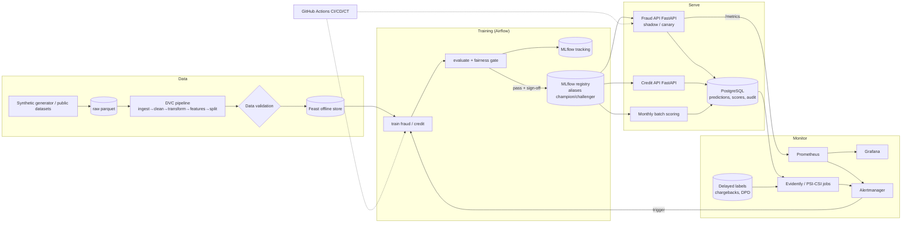

# Step 6 — Capstone: Bank Scoring Platform

**Goal:** one platform that serves **real‑time fraud scoring** and **credit scoring (API + monthly batch)** with CI/CD/CT, model registry, drift monitoring, and a governance package. Source: lifecycle from [Gambar 1, 2]; regulatory package `[TAMBAHAN]`.

## Architecture

## Milestones

| Milestone | Week | Content | Exit evidence |
|-----------|------|---------|---------------|
| CP0 Scope freeze | 11 (start) | Architecture diagram updated, backlog of gaps from M01–M12 | `capstone/plan.md` merged |
| CP1 Integrated stack | 11 | `make up` brings up Postgres, MLflow, Airflow, APIs, Prometheus, Grafana | `make smoke` green |
| CP2 Closed loop | 12 | Drift injection → alert → retrain DAG → challenger in shadow → promotion decision | Demo log `reports/capstone_loop.md` |
| CP3 Governance package | 12 | Model cards, validation report, runbooks, regulatory mapping final | All docs linked from README |
| CP4 Demo | 12 (end) | 15‑minute live demo + Q&A | Recording or live session |

## Deliverables

- [ ] `Makefile` targets: `up`, `down`, `data`, `train`, `serve`, `demo`, `smoke`, `test`
- [ ] Two registered models with `champion` alias and model cards
- [ ] Fraud API (real‑time, shadow/canary) and Credit API + batch job
- [ ] Grafana dashboards (fraud, credit) and 4+ alert rules
- [ ] Airflow DAGs: `fraud_training`, `credit_training`, `fraud_retrain`, `credit_stability`
- [ ] GitHub Actions: `ci.yml`, `cd.yml`, `security.yml`
- [ ] Governance: `docs/model-cards/*`, `docs/validation/credit_validation_report.md`, `governance/model_inventory.yaml`, `governance/regulatory_mapping.md`
- [ ] Runbooks: `docs/runbooks/{rerun-training,rollback,drift-alert,incident}.md`
- [ ] Demo script `scripts/demo.sh` and slides (≤ 10)

## Definition of Done

- [ ] From a clean clone: `make up && make data && make train && make demo` completes with exit 0 in ≤ 30 minutes on an 8‑core / 16 GB laptop.
- [ ] Fraud API p95 ≤ 50 ms at 200 RPS (Locust report committed).
- [ ] Injected drift produces PSI > 0.2 and an alert, and the retrain DAG starts automatically.
- [ ] Challenger cannot be promoted without (a) passing gates and (b) a sign‑off record by a different user.
- [ ] Rollback completes in ≤ 5 minutes, logged in audit table.
- [ ] Audit trail query returns full lineage for any `request_id`.
- [ ] CI green on `main`; security workflow has 0 HIGH/CRITICAL findings or documented exceptions.
- [ ] No PII in `data/processed/**` (test).

## Rubric (weights sum to 100 %)

| Criterion | Weight | Excellent (4) | Good (3) | Adequate (2) | Insufficient (1) |
|-----------|--------|---------------|----------|--------------|------------------|
| Architecture & integration | 15 % | One‑command bring‑up; all components wired; diagram matches code | Minor manual step | Several manual steps | Components not integrated |
| Data pipeline & reproducibility | 15 % | DVC repro identical hashes; validation blocks bad data; PIT‑correct features | Repro works, minor validation gaps | Repro partial | Not reproducible |
| Model quality & domain evaluation | 15 % | PR‑AUC/recall@P, KS/Gini/calibration with CIs on OOT; cost‑based threshold | Metrics correct, no CIs | Generic metrics only | Leakage or wrong split |
| Serving & performance | 10 % | Meets p95/RPS targets; batch=API reconciliation 0 diff | Meets targets with caveats | Works, targets missed | API unstable |
| Monitoring & drift | 15 % | 3 metric layers, PSI/CSI, delayed‑label join, alerts fire on injection | Drift + system metrics, alerts partial | Dashboards only | No monitoring |
| CI/CD/CT & release safety | 10 % | Gated CD, shadow+canary, timed rollback drill | Gated CD, one release strategy | CI only | No automation |
| Governance, fairness & security | 15 % | Complete model cards, validation report with findings, fairness gate, PII tests, threat model | Mostly complete | Partial docs | Missing |
| Demo & communication | 5 % | Clear 15‑min story, handles Q&A | Clear but long | Hard to follow | No demo |

Score = Σ(weight × level / 4). Pass ≥ 70 %.
