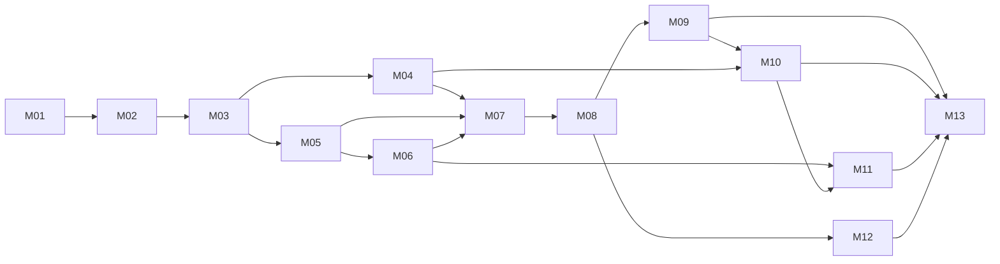

# Step 7 — Assessment & Schedule

`[ASUMSI]` Duration 12 weeks × 8 hours/week = **96 hours** total. Level: intermediate.

## Hour allocation

| Module | Hours | Level | Image source |
|--------|-------|-------|--------------|
| M01 Problem framing & architecture | 6 | Basic | [1, 2, 3] |
| M02 Data engineering & feature store | 10 | Intermediate | [1, 2, 4] |
| M03 Experiment tracking & reproducibility | 6 | Basic | [1, 5, 6] |
| M04 Training pipeline & orchestration | 6 | Intermediate | [3, 12] |
| M05 Domain model evaluation | 8 | Intermediate | [5] + TAMBAHAN |
| M06 Explainability & fairness | 6 | Intermediate | [7, 10] + TAMBAHAN |
| M07 CI/CD/CT | 6 | Intermediate | [2, 12] + TAMBAHAN |
| M08 Registry, packaging & serving | 10 | Intermediate | [1, 7, 8, 9] |
| M09 Monitoring & drift | 10 | Advanced | [1, 3, 10, 11] |
| M10 Retraining & release strategy | 6 | Advanced | [12] |
| M11 Governance & model risk | 5 | Advanced | [3, 7, 12] + TAMBAHAN |
| M12 Security & privacy | 4 | Intermediate | [9] + TAMBAHAN |
| M13 Capstone | 13 | Advanced | [1, 2] |
| **Total** | **96** | | |

## Weekly schedule

| Week | Module(s) | Tasks | Deliverables | Hours |
|------|-----------|-------|--------------|-------|
| 1 | M01 (6) + M02 (2) | Architecture diagrams, label definitions, cost matrix; generate synthetic data; DVC init | Design docs, ADR‑0001, `pipeline_steps.py`, `dvc init` | 8 |
| 2 | M02 (8) | DVC stages, validation suites, shared transforms, Feast, temporal split tests | `dvc.yaml` ×2, GE suites, `feature_repo/`, `test_no_leakage.py` | 8 |
| 3 | M03 (6) + M04 (2) | MLflow logging, baselines, reproducibility check; Airflow up | Training scripts, `requirements.lock`, run comparison CSV | 8 |
| 4 | M04 (4) + M05 (4) | DAGs + backfill; fraud evaluation & threshold | 2 DAGs, `fraud_eval.md`, `threshold.json` | 8 |
| 5 | M05 (4) + M06 (4) | Credit evaluation (KS/Gini/calibration), gate; SHAP | `credit_eval.md`, `gate.py`, SHAP reports | 8 |
| 6 | M06 (2) + M07 (6) | Reason codes, fairness gate; CI, behavioral tests, CD, CT trigger | `reason_codes.py`, `ci.yml`, `cd.yml`, behavioral tests | 8 |
| 7 | M08 (8) | Registry aliases + model cards, Fraud API, Credit API, Docker, batch scoring | APIs, Dockerfile, batch job | 8 |
| 8 | M08 (2) + M09 (6) | Load test; Prometheus/Grafana, PSI/CSI | Load test report, dashboards, `psi.py` | 8 |
| 9 | M09 (4) + M10 (4) | Drift injection, delayed‑label join, alerts; retrain DAG, shadow mode | Drift reports, alert rules, `fraud_retrain.py` | 8 |
| 10 | M10 (2) + M11 (5) + M12 (1) | Canary + rollback drill; inventory, model cards, validation report; data classification | Rollback log, validation report, inventory | 8 |
| 11 | M12 (3) + M13 (5) | Tokenization, roles, security workflow; capstone CP0–CP1 | `security.yml`, `roles.sql`, integrated stack | 8 |
| 12 | M13 (8) | Capstone CP2–CP4 | Closed‑loop demo, governance package, presentation | 8 |
| | | | **Total** | **96** |

## Module dependency map

**Parallel paths** (can be swapped or run side by side if you are ahead):

- M06 (explainability) can run in parallel with M04 (orchestration) once M05 is done.
- M12 (security) can start any time after M08; tokenization (Task A) can even start after M02.
- M11 documentation can be drafted incrementally from M05 onward.

## Per‑module rubric

Each module is scored on the same 4 criteria (applied to that module's acceptance criteria):

| Criterion | Weight | 4 — Excellent | 3 — Good | 2 — Adequate | 1 — Insufficient |
|-----------|--------|---------------|----------|--------------|------------------|
| Acceptance criteria met | 50 % | 100 % of DoD checkboxes verified | ≥ 80 % | ≥ 60 % | < 60 % |
| Both use cases covered | 20 % | Task A and B complete with equal depth | Both done, one shallow | One complete, other partial | Only one |
| Reproducibility & code quality | 20 % | Runs from clean clone via documented command; tests pass in CI | Runs with minor manual steps | Runs only on author machine | Does not run |
| Domain reasoning | 10 % | Pitfalls explicitly checked with evidence (tests/reports) | Pitfalls discussed | Mentioned only | Ignored |

Module score = Σ(weight × level / 4). Pass ≥ 70 %.

## Overall grade

| Component | Weight |
|-----------|--------|
| M01–M12 module scores (average) | 60 % |
| Capstone (rubric in [`capstone/README.md`](../capstone/README.md)) | 40 % |
