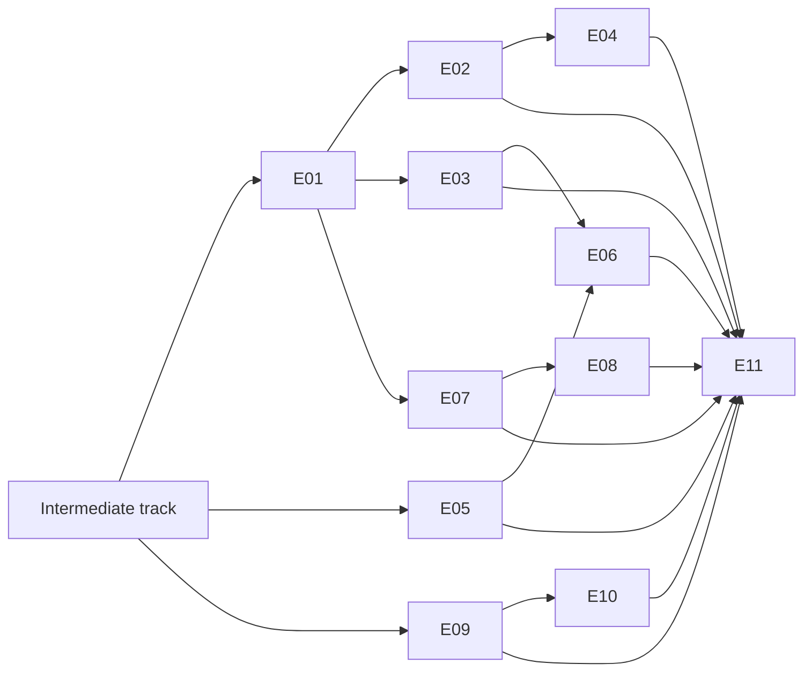

# Expert Track — Fraud Detection & Credit Scoring MLOps

Builds on the [intermediate track](../README.md). Everything here is `[TAMBAHAN]` (beyond the 12 source images). Where an expert module extends an image topic, the image is noted. The research behind these choices is in [docs/06-expert-research-report.md](../docs/06-expert-research-report.md).

- **Entry requirement:** intermediate track passed (≥ 70 %) **or** the [entry assessment](#entry-assessment) below.
- **Duration:** 10 weeks × 8 h = **80 h** `[ASUMSI: same weekly load as the intermediate track]`
- **Output:** a platform design you could defend before a bank's AI committee, model risk function, and OJK examiners.

## Intermediate vs Expert

| Dimension | Intermediate (M01–M13) | Expert (E01–E11) |
|-----------|------------------------|------------------|
| Data | Batch DVC pipelines, Feast offline store | Streaming features (Kafka + Flink), online/offline parity proven with tests |
| Fraud modeling | Tabular GBM, cost threshold | Graph ML for fraud rings, learning under delayed labels, adversarial robustness |
| Credit modeling | WoE scorecard + GBM challenger, 12‑month PD | Monotonic / glass‑box GBM, lifetime PD via survival models, macro scenarios for PSAK 109 (ex‑PSAK 71) ECL, reject inference |
| Decisions | Fixed threshold | Causal uplift (credit limits), off‑policy evaluation (fraud thresholds/rules) |
| Serving | FastAPI in Docker, p95 ≤ 50 ms | ONNX/Triton, Kubernetes + GitOps, SLOs and error budgets, p99 ≤ 20 ms |
| Monitoring | PSI/CSI, Evidently, alert rules | Label‑free performance estimation, conformal coverage monitoring, adversarial drift |
| Privacy | Tokenization, RBAC | Federated learning across institutions, differential privacy, synthetic data |
| Governance | Model card, validation report | AI governance aligned to OJK *Tata Kelola Kecerdasan Artifisial Perbankan Indonesia* (2025), policy‑as‑code gates, EU AI Act benchmark |
| GenAI | — | LLM investigator copilot with guardrails and an evaluation suite |

## Modules

| # | Module | Hours | Extends |
|---|--------|-------|---------|
| E01 | [Real‑time streaming feature platform](E01-streaming-features.md) | 10 | M02, M08 · [Gambar 1, 4] |
| E02 | [Graph ML for fraud rings & entity resolution](E02-graph-ml-fraud.md) | 8 | M02, M05 |
| E03 | [Learning under delayed & noisy labels](E03-delayed-labels-active-learning.md) | 6 | M05, M09 · [Gambar 10, 11] |
| E04 | [Adversarial robustness & red‑teaming fraud models](E04-adversarial-robustness.md) | 6 | M05, M12 |
| E05 | [Advanced credit risk: glass‑box GBM, lifetime PD, PSAK 109 ECL](E05-advanced-credit-risk.md) | 10 | M05, M06, M11 |
| E06 | [Causal decisioning & off‑policy evaluation](E06-causal-decisioning.md) | 6 | M05, M10 |
| E07 | [High‑performance serving & Kubernetes‑native platform](E07-serving-platform-k8s.md) | 8 | M08, M10 · [Gambar 8, 9, 12] |
| E08 | [Privacy‑enhancing ML: federated learning, DP, synthetic data](E08-privacy-enhancing-ml.md) | 6 | M12 |
| E09 | [AI governance at scale & policy‑as‑code](E09-ai-governance-at-scale.md) | 6 | M11 · [Gambar 7] |
| E10 | [LLMOps for fraud operations](E10-llmops-fraud-ops.md) | 4 | M09, M12 |
| E11 | [Expert capstone](E11-expert-capstone.md) | 10 | all |
| | **Total** | **80** | |

Readings for every module: [expert/reading-list.md](reading-list.md).

## Weekly schedule

| Week | Modules (hours) | Main deliverables | Hours |
|------|-----------------|-------------------|-------|
| 1 | E01 (8) | Kafka + Flink velocity features, Redis online store | 8 |
| 2 | E01 (2) + E02 (6) | Parity test suite; transaction graph + GNN baseline | 8 |
| 3 | E02 (2) + E03 (6) | Ring detection report; active learning + conformal routing | 8 |
| 4 | E04 (6) + E05 (2) | Constrained evasion attack + defenses; monotonic GBM start | 8 |
| 5 | E05 (8) | Glass‑box PD, survival lifetime PD, ECL scenarios | 8 |
| 6 | E06 (6) + E07 (2) | Uplift model for limits, OPE of fraud policies; ONNX export | 8 |
| 7 | E07 (6) + E08 (2) | Triton on kind + Argo CD + SLOs; FL setup | 8 |
| 8 | E08 (4) + E09 (4) | FL + DP results; AI governance framework | 8 |
| 9 | E09 (2) + E10 (4) + E11 (2) | Policy‑as‑code gates; LLM copilot + eval suite; capstone plan | 8 |
| 10 | E11 (8) | Expert capstone defense | 8 |
| | | **Total** | **80** |

## Dependency map

Parallel paths: fraud path (E01→E02→E03→E04) and credit path (E05→E06) are independent until E11. E09 governance can start in week 1 and run alongside.

## Entry assessment

For learners skipping the intermediate track. Pass = all 5 in ≤ 8 h:

- [ ] Reproduce a DVC + MLflow training run from a clean clone (identical `dvc.lock`, metric ±0.001).
- [ ] Ship a FastAPI model in a non‑root Docker image with `/health` and `/metrics`, p95 ≤ 50 ms at 100 RPS.
- [ ] Compute PSI/CSI and an out‑of‑time KS/Gini report for a credit model.
- [ ] Write a GitHub Actions workflow with a model evaluation gate.
- [ ] Explain (in writing, 1 page) label delay and reject bias with a mitigation for each.

## Expert rubric (per module)

| Criterion | Weight | 4 — Expert | 3 — Proficient | 2 — Developing | 1 — Insufficient |
|-----------|--------|-----------|----------------|----------------|------------------|
| DoD met | 40 % | 100 % verified | ≥ 80 % | ≥ 60 % | < 60 % |
| Trade‑off analysis | 20 % | Quantified alternatives (latency, cost, risk) with a recommendation | Alternatives listed, partly quantified | One option only | None |
| Rigor | 20 % | Confidence intervals / statistical tests / ablations; threats to validity stated | Some statistics | Point estimates only | Unverified claims |
| Production & governance readiness | 20 % | Runbook, monitoring, rollback and governance evidence for the new component | Two of the four | One | None |

Overall expert grade: E01–E10 average 60 % + E11 capstone 40 %. Pass ≥ 75 %.
